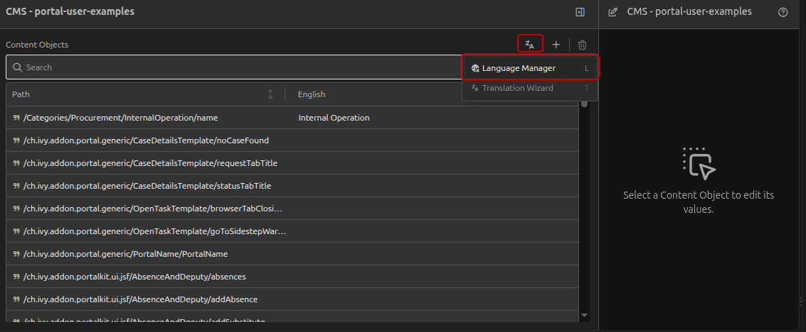
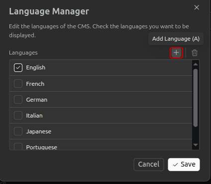
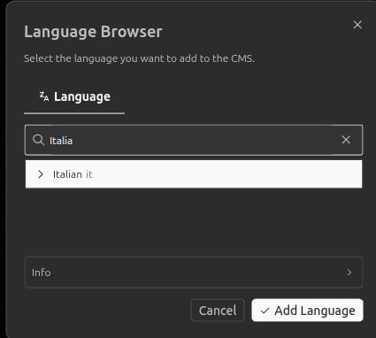
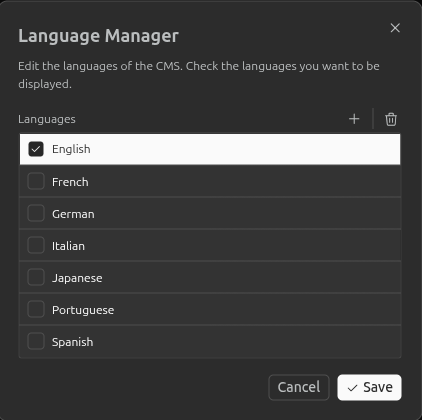
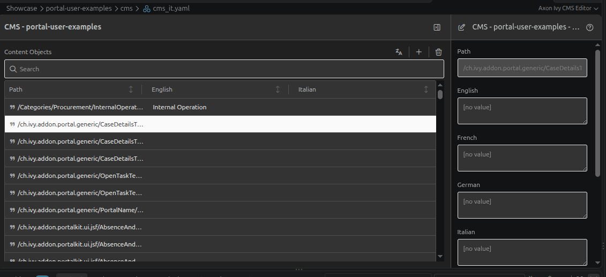

.. _customization-add-new-language:

Add a New Language
******************

Portal ships with English (``en``), German (``de``), French (``fr``), Spanish (``es``) and Japanese (``ja``).
To add another language, for example Italian (``it``), use the Language Manager of the
:doc-url:`CMS Editor </reference/cms/cms-editor.html>`.

.. note::
   Do not edit the delivered Portal projects. Your changes would be lost on every Portal update.

HowTo: Add a New Language to Portal
===================================

#. **Create a customization project**

   - Create an Axon Ivy project that has the Portal project as a required project.
   - If you already have a project for Portal customization, reuse it.

#. **Add the language in the CMS editor of your project**

   - Open the :doc-url:`CMS Editor </reference/cms/cms-editor.html>` of your project.
   - Click :guilabel:`Language Tools` and select :guilabel:`Language Manager`.

     |cms-language-tools-menu|

   - Click :guilabel:`Add Language` and select the new language (for example Italian, ``it``).
     Refer to `Java supported locales <https://www.oracle.com/java/technologies/javase/jdk25-suported-locales.html>`_ for valid codes.

     |cms-language-manager-add-language|

   - In the Language Browser, search for the language name (for example Italian), select it and click :guilabel:`Add Language`.

     |cms-language-browser-search|

   - Click :guilabel:`Save`. You do not need to select the new language as the displayed language here.
     You can choose it later in :guilabel:`My Profile` in Portal.

     |cms-language-manager-select-italian|

#. **Translate the Portal CMS entries**

   - Define the Portal Content Objects that you want to translate with the same URI in your project.
     Your values override the Portal values.
   - Enter the translated values in the new language column.

     |cms-new-language-column|

   - Base your translations on the existing English (``en``) or German (``de``) values.

#. **Deploy**

   Deploy your project together with Portal, then select the new language in :guilabel:`My Profile` to verify the translations.

.. tip::
   Content Objects without a value in the new language are displayed in the default language.
   Translate all entries that users see before you release the language.

